<p align="center">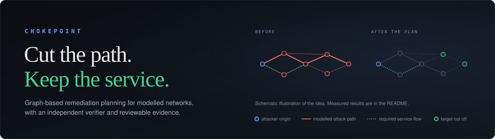</p>

<p align="center">


<a href=".github/workflows/ci.yml"></a>
</p>

**CHOKEPOINT is a graph-based security-planning prototype.** Given a model of a network, it finds a cost-effective set of remediation actions that cuts the *modelled* attack paths to critical systems while keeping the service flows the network needs, then has a separate verifier re-check the plan and produces evidence you can review: a PDF report and a JSON receipt with a SHA-256 fingerprint.

**The problem.** Connected systems contain routes an attacker could use to reach critical targets, but you cannot simply cut every connection: water pumps, traffic signals and backups depend on some of them. Every fix also costs effort and downtime. CHOKEPOINT treats this as an optimisation problem with two constraints: *block the modelled routes to critical targets* and *keep every required service flow permitted*, at the lowest modelled cost.

**What is different.** The optimizer and the verifier are two separate programs. The verifier is standard-library-only, imports nothing from the planner (a test enforces it), and re-derives reachability, flows and costs from the raw scenario. Solver claims are honest: `OPTIMAL` appears only when the exact search finished. Every selected action comes with an explanation that separates computed facts from inference and from human-review suggestions.

<p align="center">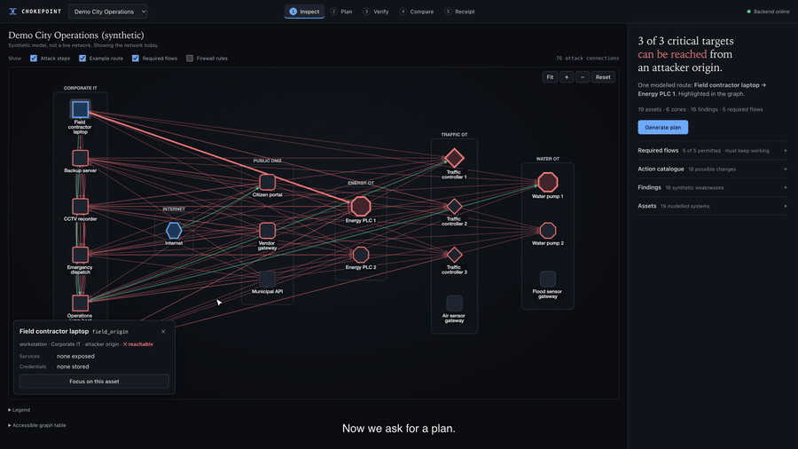</p>

<p align="center"><em>A 15-second excerpt of the real application (plan, then before/after).<br><strong><a href="https://youtu.be/fO2kn9lb7pl">Watch the full 2:36 narrated demo on YouTube</a></strong></em></p>

> **Scope.** CHOKEPOINT evaluates network *models you supply*. It does not scan networks, discover vulnerabilities, collect traffic, or change any firewall or control system. Built-in scenarios are synthetic. Results describe the model, not a live network.

**Jump to:** [Demo video](https://youtu.be/fO2kn9lb7pl) · [Verified results](#verified-results) · [How it works](#how-it-works) · [Screenshots](#screenshots) · [Import a scenario](#import-your-own-scenario) · [Quick start](#quick-start) · [API](#api) · [Architecture](#architecture) · [Tests](#tests-and-validation) · [Limitations](#scope-security-and-limitations) · [Roadmap](#roadmap)

---

## Verified results

Recomputed from the running application for the synthetic `demo_city` scenario (19 assets, 6 zones, 16 findings, 5 required flows, 18 catalogue actions):

| | Before | After the plan |
|---|---|---|
| Critical targets reachable (modelled) | **3** | **0** |
| Modelled attack connections | **76** | **27** (49 removed) |
| Required service flows permitted | 5 of 5 | **5 of 5** |

- **Selected actions:** D01, D03, D08, D09, D10 (five actions)
- **Modelled cost:** **105 dh** (decihours; `effort + 2 × downtime`, a planning unit, not money)
- **Solver status:** `OPTIMAL` (exact search finished after evaluating 28 candidate action sets)
- **Verifier:** `VERIFIED`, 10 of 10 checks passed
- **Receipt fingerprint:** `sha256:724410146d04f2aa5c3eeb88e0023dad37ce4858172436d085864d6637c09a37`

The smaller `canonical_city` scenario plans to `OPTIMAL` with actions A01 to A04 at 200 dh. A reduction in modelled edges is a statement about the model; it is not a quantified real-world risk reduction. D01 is *mandatory* in the scenario and is not individually necessary for cutting the targets; D03, D08, D09 and D10 each are (see [explanations](#explanations-and-evidence)).

## How it works

`Model → Inspect → Plan → Verify → Compare → Report`

| Stage | What happens | Where |
|---|---|---|
| **Model** | A scenario JSON lists zones, assets (with services and stored credentials), findings, firewall rules, required flows, attacker origins, critical targets and priced actions. | `backend/scenarios/*.json`, `scenario/validate.py` |
| **Inspect** | An attack edge `A → B` exists if an attacker on A can exploit an unpatched finding on a service of B that a firewall rule lets A reach, or can reuse credentials A stores for B. The workspace shows what is reachable from the origins and one example route. | `graph/semantics.py` |
| **Plan** | Branch-and-bound search over catalogue actions finds the lowest-cost set that leaves no target reachable and every required flow permitted. | `solver/exact.py` |
| **Verify** | The independent verifier rebuilds the graph from the raw JSON and runs ten checks: scenario well-formed, IDs known and unique, no exclusions, mandatory actions present, cost recomputed, claimed cost matches, cost cap, required flows preserved, targets unreachable. | `chokepoint_verifier/` |
| **Compare** | Before/after graphs from two real `/graph` calls; removed connections are drawn dashed. | `GraphCanvas.tsx` |
| **Report** | PDF report and JSON receipt. | `report/pdf.py`, `receipt.py` |

### Optimizer and solver statuses

The planner searches sets of actions, starting from the mandatory ones. At each step it finds one shortest attack path to a target and branches only on actions that neutralise an edge on that path, discarding any set that breaks a required flow and any branch that cannot beat the best plan found. Costs are integers: `modelled cost = effort + 2 × downtime`, in decihours (`Action.cost_dh`). Ties break by cost, then action count, then action IDs, so results are deterministic.

| Status | Meaning |
|---|---|
| `OPTIMAL` | The search finished within its budget. No cheaper plan exists in the catalogue under this model and objective. |
| `FEASIBLE_NOT_PROVEN` | A plan satisfying all constraints was found but optimality is **not** established (greedy strategy, or the search budget ran out and a heuristic or the best plan so far is returned). |
| `INFEASIBLE_*`, `NO_PLAN_FOUND_HEURISTIC` | No valid plan was produced. No plan, receipt or "verified" label is shown. |

### Verifier and receipts

`VERIFIED` means all checks passed *inside the model*. It does not prove the plan is the cheapest, that the scenario data is true, or that any real network is secure. A rejected plan is reported as rejected, with the failing checks.

The receipt is canonical JSON containing the scenario fingerprint, selected actions and costs, solver status as claimed, and the verifier's check results. Its `receipt_fingerprint` is the SHA-256 of that canonical form. It detects changes to the record. **It is a hash, not a digital signature**, and does not show who produced it. Re-verify in the UI recomputes the receipt and compares fingerprints.

### Explanations and evidence

Each selected action is explained in three separate parts (`explain.py`):

1. **Facts**, computed with the same graph engine the solver uses: what the action changes, how many modelled connections it removes when applied alone, and whether removing *only that action from this plan* would leave a target reachable ("necessary within this plan"). That is a local leave-one-out result, not a global necessity proof.
2. **Inference**, labelled as not established by the solver (for example why a rule was narrowed rather than removed).
3. **Confirm before real implementation**, human-review suggestions that are not model output.

## Screenshots

<table>
<tr><td width="50%">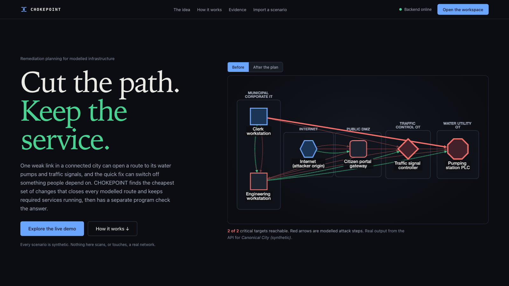<br><sub><b>Landing page.</b> The hero graph and the scroll story are built from live API results.</sub></td>
<td width="50%">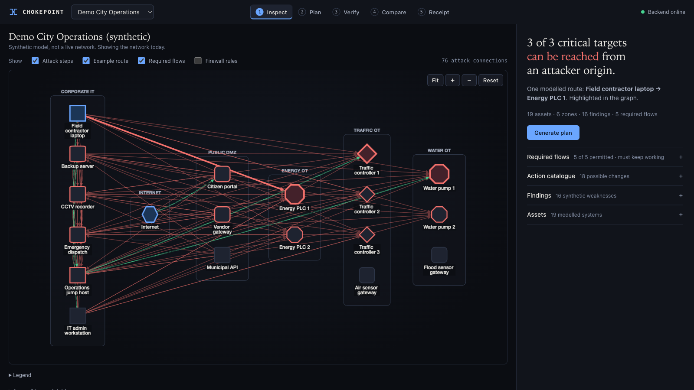<br><sub><b>Baseline.</b> 3 of 3 critical targets reachable; red = modelled attack paths, green dotted = required flows.</sub></td></tr>
<tr><td>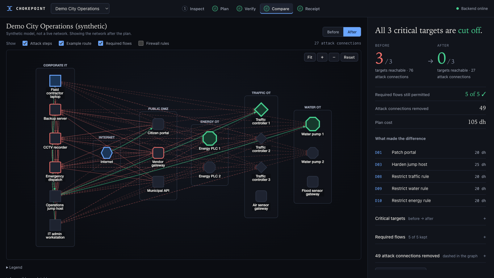<br><sub><b>Before and after.</b> Dashed arrows are connections the plan removes.</sub></td>
<td>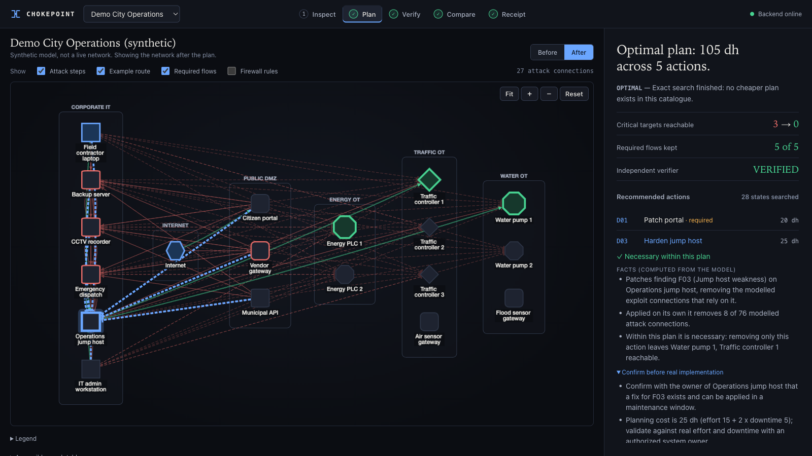<br><sub><b>Action explanation</b> for D03: computed facts, necessity within the plan, items to confirm.</sub></td></tr>
<tr><td>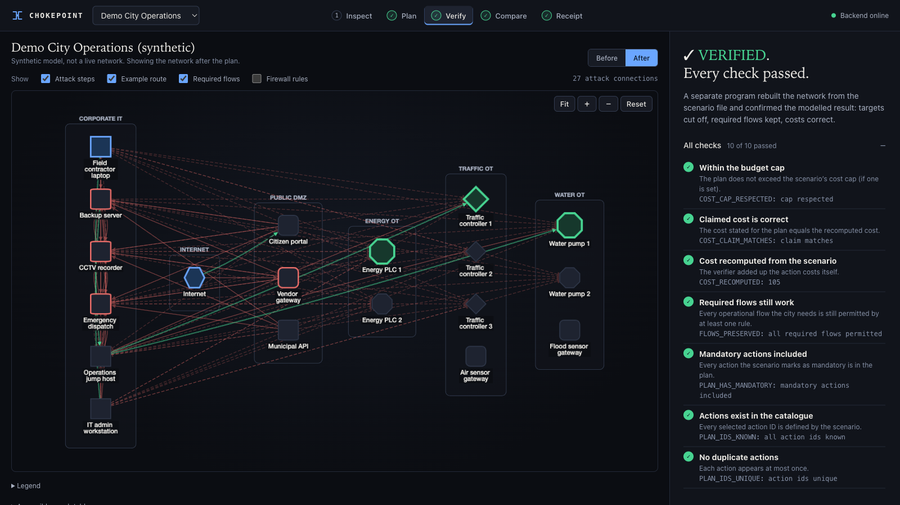<br><sub><b>Independent verification.</b> Verdict first, then every check.</sub></td>
<td>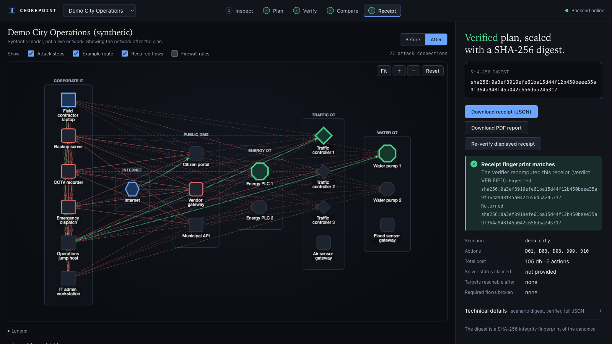<br><sub><b>Receipt.</b> SHA-256 fingerprint, JSON and PDF downloads, re-verify.</sub></td></tr>
</table>

<p align="center">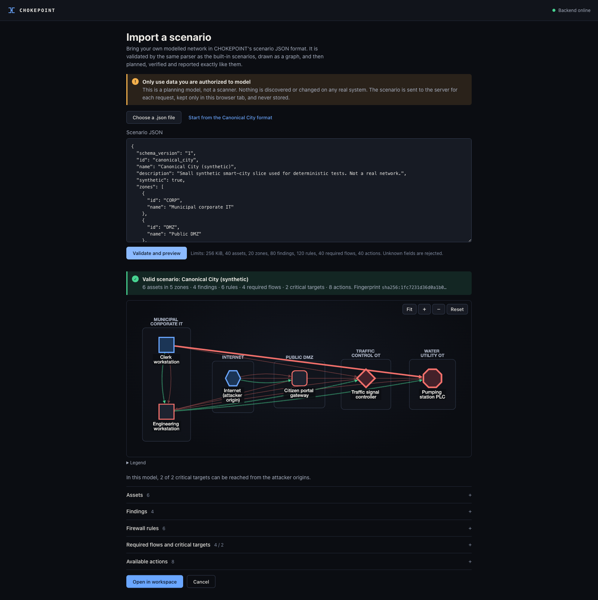<br><sub><b>Scenario import.</b> Validation result, warnings and a graph preview before anything is planned.</sub></p>
<p align="center">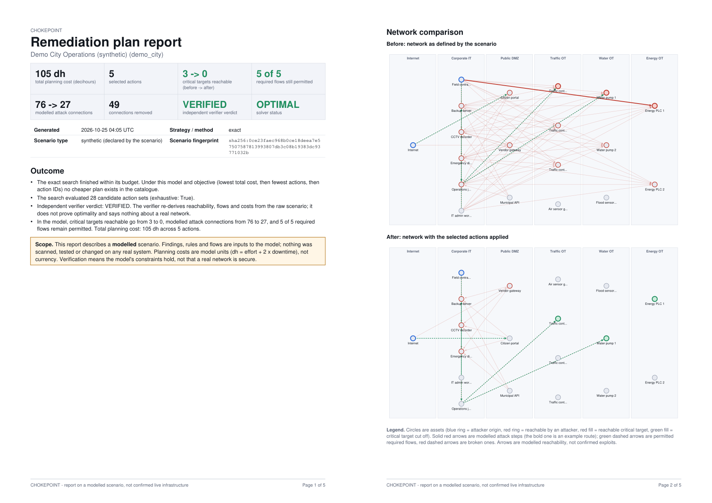<br><sub><b>PDF report</b> (pages 1 and 2 of the real output for demo_city).</sub></p>

## Import your own scenario

Open **Import a scenario** (landing-page navigation, or `/import`). Choose a `.json` file or paste JSON, or click **Start from the Canonical City format** for a template. **Validate and preview** sends the document to `POST /api/v1/scenarios/validate`, which uses the same parser as the built-in scenarios and returns either path-level errors (`/actions/2/params/rule_id: unknown reference`) or the normalised scenario, warnings and a graph preview. **Open in workspace** then runs the full workflow on it.

- **Format:** schema version `"1"`; the fields in [`backend/scenarios/canonical_city.json`](backend/scenarios/canonical_city.json) (a valid, complete example) and no others. Unknown fields are rejected. The schema is defined by `backend/src/chokepoint/scenario/validate.py`.
- **Import limits:** 256 KiB; 40 assets, 20 zones, 80 findings, 120 rules, 40 required flows, 40 actions, 10 origins, 10 targets, 8 services and 8 credentials per asset; search budget at most 1000 states.
- **Lifecycle:** the imported scenario is kept only in the browser tab (`sessionStorage`) and sent inline with each request. The server stores nothing and never adds it to the built-in scenarios.
- **Not included:** live scanning, automatic extraction from real inventories, or a visual editor. You supply the model; the tool evaluates it.

## Quick start

Requirements: **Python 3.11+**, **Node.js 20+** with npm (CI uses Node 22).

```bash
git clone https://github.com/Sidd927/Chokepoint.git
cd Chokepoint
make setup      # backend/.venv (python3.13, 3.12 or 3.11) + pip install -e backend + npm ci
make dev        # backend on :8000 and frontend on :5173; Ctrl-C stops both
```

Open <http://127.0.0.1:5173>. If a port is busy: `lsof -nP -iTCP:8000 -iTCP:5173 -sTCP:LISTEN`.

```bash
make test       # backend pytest + frontend Vitest
make build      # TypeScript + production Vite build
make e2e        # Playwright (needs a one-time: cd frontend && npx playwright install chromium)
```

Command-line use (from the repository root):

```bash
PYTHONPATH=backend/src backend/.venv/bin/python -m chokepoint.cli plan backend/scenarios/demo_city.json
PYTHONPATH=backend/src backend/.venv/bin/python -m chokepoint.cli verify backend/scenarios/demo_city.json --actions D01,D03,D08,D09,D10 --claimed-cost 105
```

Optional configuration is in [`.env.example`](.env.example); there are no secrets.

## API

Base path `/api/v1`. Checked-in contract: [`docs/openapi.json`](docs/openapi.json) (regenerate with `scripts/export_openapi.py`). Requests are strict (unknown fields rejected), bodies are capped at 256 KiB, errors use one envelope `{error: {code, message, details}}`.

| Method and path | Purpose |
|---|---|
| `GET /health` | Service status and number of built-in scenarios |
| `GET /scenarios`, `GET /scenarios/{id}` | Built-in scenario summaries and full definition |
| `POST /scenarios/validate` | Validate a user-supplied scenario; returns errors or normalised scenario, warnings and graph |
| `POST /graph` | Attack graph with a given set of actions applied |
| `POST /plan` | Run the solver (`strategy`: `exact` or `greedy`, `max_nodes`); returns actions, cost, status, proof metadata, explanations, verification and receipt |
| `POST /verify` | Independently verify any set of action IDs, optionally with a claimed cost |
| `POST /report` | PDF report; the server recomputes everything from the scenario and either solver settings or action IDs |

`/graph`, `/plan`, `/verify` and `/report` take either `scenario_id` (built-in) or an inline `scenario` (imported), never both.

## Architecture

<p align="center">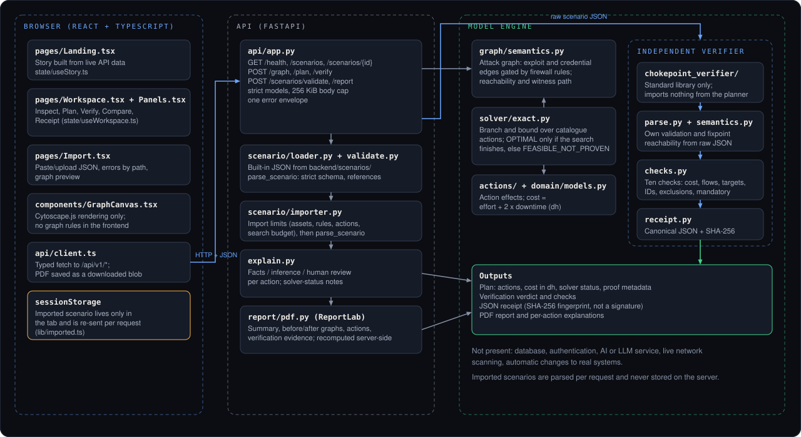</p>

The diagram shows only modules that exist. There is no database, no authentication layer and no AI or LLM component: planning, verification, explanations and reports are deterministic code. See also [`docs/ARCHITECTURE.md`](docs/ARCHITECTURE.md) and [`docs/ALGORITHMS.md`](docs/ALGORITHMS.md) (written earlier in the project; where they differ from the code, the code is authoritative).

**Backend** (`backend/`): Python 3.11+, FastAPI 0.115, Pydantic 2, Uvicorn, ReportLab 5 (PDF). **Frontend** (`frontend/`): React 18, TypeScript 5.7, Vite 6, React Router 7, Cytoscape.js 3.31. **Tests:** pytest, Vitest with Testing Library, Playwright.

```text
backend/src/chokepoint/            API, scenario parsing, graph, solver, explanations, PDF
  api/app.py  scenario/{validate,importer,loader}.py  graph/semantics.py
  solver/exact.py  explain.py  report/pdf.py  cli.py
backend/src/chokepoint_verifier/   independent verifier (standard library only) and receipts
backend/scenarios/                 built-in synthetic scenarios (canonical_city, demo_city)
backend/tests/                     pytest suites, brute-force oracle, receipt vectors
frontend/src/                      pages (Landing, Workspace, Import), components, state, API client
frontend/e2e/                      Playwright journeys
docs/  DESIGN.md                   design notes, OpenAPI, project status
```

## Tests and validation

| Suite | Command | Scope |
|---|---|---|
| Backend | `make backend-test` | scenario validation, graph semantics, solver against a brute-force oracle, verifier independence, receipts, API contract, import limits, explanations, PDF |
| Frontend unit | `make frontend-test` | API client, state handling, import page, explanation rendering |
| Browser end-to-end | `make e2e` | landing story, full workspace journey with real downloads, import flow, errors, three viewport widths |

Last local run (macOS, Python 3.11, Node 26): 63 backend tests, 21 frontend tests and 19 Playwright tests passed, and the production build succeeded. The GitHub Actions workflow in `.github/workflows/ci.yml` runs the same `make` targets; its remote result is shown by the badge above and was not checked as part of this local validation. No coverage figure is claimed.

## Scope, security and limitations

- Results are only as good as the supplied model. Edges are modelled reachability, not proof of exploitability.
- The optimizer works within the implemented model (allow-only, protocol-agnostic rules; no exploit prerequisites, privileges, probabilities or timing) and its search budget. `FEASIBLE_NOT_PROVEN` plans may not be cheapest. The exact search is exponential in the catalogue size.
- The verifier shares the written model rules with the planner, so it catches implementation errors and plan violations, not mistakes in the model itself.
- Implemented safeguards: strict request models, a body-size cap, import limits, a capped search budget for imports, uniform errors without stack traces, no server-side storage of imports, no external calls from report generation, untrusted scenario text escaped in PDFs (non-Latin text prints as `?`).
- Not provided: authentication, per-user isolation, rate limiting, request timeouts (a worst-case import can occupy a worker for about a minute), audit logging. Production use would need those, operational validation and a security review. Treat imported data as sensitive: it travels to the server you run.
- No LICENSE file is present in this repository; no licence is granted by this README.

## Roadmap

Future work, not implemented: a schema-guided scenario editor; mapping from authorised asset inventories into the scenario format; richer provenance for findings; deployment hardening (auth, quotas, timeouts, audit logs); published scalability benchmarks on larger scenarios; configurable report templates.

## More documentation

[`DESIGN.md`](DESIGN.md) (visual system and research) · [`docs/PROJECT_STATUS.md`](docs/PROJECT_STATUS.md) · [`docs/TESTING.md`](docs/TESTING.md).
