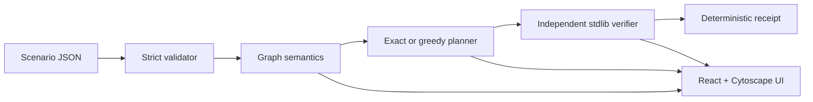

# CHOKEPOINT

CHOKEPOINT is a defensive remediation-planning engine for a **synthetic, modelled** smart-city / critical-infrastructure network. It finds a lowest-cost set of catalogue actions that removes logical origin-to-target reachability while preserving required service flows, then independently verifies the result and emits a deterministic receipt.

It does **not** scan, exploit, control, or change a real system. A graph edge is modelled reachability, not proof of exploitability. `VERIFIED` means the independent verifier accepted the modelled constraints; it is not a claim of real-world security, deployment, or optimality unless the solver status is `OPTIMAL`.

This is a separate, new build. It does not copy source or assets from ChronoForge, and it does not assert compliance with any competition's originality rules.

## How it works



The scenario owns all structure and action costs. The planner derives integer decihour costs as `effort_dh + 2*downtime_dh`. Exact search minimizes `(total cost, action count, sorted action IDs)` with deterministic node budgets. The verifier independently evaluates permissions, required flows, reachability, costs, exclusions, mandatory actions, and caps using a least-fixpoint formulation.

## Implemented features

- Strict versioned scenario validation with JSON-pointer-style paths and static warnings.
- Multi-reason attack graphs with exploit and credential causes.
- Zone/asset rule matching, restricted and removed rules, required-flow preservation.
- Exact branch-and-bound planning and greedy fallback with honest statuses.
- Independent standard-library-only verifier; it never calls the optimizer.
- Canonical JSON, scenario fingerprints, receipt fingerprints, and tamper detection.
- FastAPI health, scenario, graph, plan, and verify endpoints.
- CLI validation, planning, and verification.
- Interactive Cytoscape graph: zones laid out as columns by attack distance, asset shape by kind, attack/example-path/flow/firewall layers, hover focus, node/edge detail panel, legend, "blocked by plan" edges in the after view, fit/zoom/reset, and an accessible table fallback. Cytoscape is code-split and loaded only when a scenario opens.
- Landing page (`/`) with a scroll-driven story built from live API data (real required flows, attack routes, a flow-breaking quick fix, the optimal plan, the verifier result); no scroll hijacking, reduced-motion aware.
- Graph-first workspace (`/scenarios/:id`): top bar with five-step navigator, one headline result per step, details behind disclosures, purposeful empty states. Design system in `DESIGN.md`.

## Repository structure

```text
backend/src/chokepoint/       core models, validation, graph, solver, API, CLI
backend/src/chokepoint_verifier/ independent parser, fixpoint, checks, receipts
backend/scenarios/             canonical and demo synthetic scenarios
backend/tests/                 unit, API, oracle, adversarial, receipt tests
frontend/src/                  React shell, Cytoscape graph, workflow views
frontend/e2e/                  Playwright journey, error, switching and responsive specs
.github/workflows/ci.yml       CI (unit tests, build, browser e2e)
DESIGN.md                      design system and research record
docs/                          architecture, algorithms, API, audit, testing
```

## Requirements

- Python 3.11+ (developed and tested with 3.11.15).
- Node 20+ and npm (tested with Node 26.4.0 / npm 11.17.0).
- No database, Docker, credentials, paid service, or runtime network integration.

## Setup and run

Requirements: **Python >= 3.11** (macOS system `python3` is 3.9 and will not work; use `brew install python@3.11`) and **Node.js >= 20** with npm. Tested with Python 3.11.15, Node 26.4.0, npm 11.17.0 on macOS arm64.

```bash
make setup        # creates backend/.venv with python3.13/3.12/3.11, installs backend + `npm ci`
make test         # backend pytest + frontend vitest
make build        # frontend production build
make dev          # starts backend :8000 and frontend :5173 together (Ctrl-C stops both)
```

Override the interpreter with `make setup PYTHON=/path/to/python3.11`. If `backend/.venv` was created with an older Python, `make setup` is not enough on its own; recreate it with `python3.11 -m venv --clear backend/.venv`.

Open `http://127.0.0.1:5173`. Backend health: `http://127.0.0.1:8000/api/v1/health`. The Vite dev server proxies `/api` to the backend (`VITE_PROXY_TARGET`, default `http://127.0.0.1:8000`).

Running the processes manually, in two terminals:

```bash
PYTHONPATH=backend/src backend/.venv/bin/python -m uvicorn chokepoint.api.app:app --host 127.0.0.1 --port 8000
cd frontend && npm run dev -- --host 127.0.0.1 --port 5173
```

Port already in use? `lsof -nP -iTCP:8000 -iTCP:5173 -sTCP:LISTEN`, then `kill <PID>`.

Browser end-to-end tests (`make e2e`) use their own ports 8010/5180 and need a one-time `cd frontend && npx playwright install chromium`.

If that command prints `extracting archive` and then never finishes (observed with Playwright 1.49.1 on Node 26), the download itself is fine; the extractor is stuck. Stop it and unpack the cached zip yourself:

```bash
pkill -f "playwright install"
Z=$(ls /var/folders/*/*/T/playwright-download-chromium-*.zip | head -1)
D=~/Library/Caches/ms-playwright/chromium-1148   # build number from: ls ~/Library/Caches/ms-playwright
rm -rf "$D"/chrome-mac && unzip -q "$Z" -d "$D" && touch "$D/INSTALLATION_COMPLETE"
```

Using Node 20 or 22 avoids the problem.

Optional configuration is documented in `.env.example`; do not put secrets in scenario files or committed environment files.

## CLI

```bash
PYTHONPATH=backend/src backend/.venv/bin/python -m chokepoint.cli validate backend/scenarios/canonical_city.json
PYTHONPATH=backend/src backend/.venv/bin/python -m chokepoint.cli plan backend/scenarios/canonical_city.json --json
PYTHONPATH=backend/src backend/.venv/bin/python -m chokepoint.cli verify backend/scenarios/canonical_city.json --actions A01,A02,A03,A04 --claimed-cost 200
```

The canonical scenario currently produces `OPTIMAL` with actions `A01,A02,A03,A04`, total cost `200 dh`, and independent verification `VERIFIED`.

## API and tests

The API base is `/api/v1`. The checked-in contract is `docs/openapi.json`; regenerate it with:

```bash
PYTHONPATH=backend/src backend/.venv/bin/python scripts/export_openapi.py
```

Run the checks independently or together:

```bash
make backend-test       # pytest: core, oracle, verifier, API, CLI, adversarial
make frontend-test      # Vitest + React Testing Library
make build              # TypeScript + production Vite build
make test               # backend and frontend suites
cd frontend && npm run e2e  # Playwright; starts both servers via config
```

## Demo script (about two minutes)

1. `make dev`, open `http://127.0.0.1:5173`. Scroll the landing story (or click **Explore the live demo**); the page shows **Backend online** from a live health check and every number on it comes from the API.
2. In **Demo City**, *Inspect* says how many critical targets an attacker can reach and shows one concrete path; the graph shows zones as columns from the attacker's side to the critical systems.
3. Click **Generate plan**. The solver reports `OPTIMAL`, 5 actions, 105 dh; the graph switches to *After*, critical targets turn green, and removed attack steps appear as faint dashed "blocked" arrows. Expand an action to see what it changes.
4. **Verify** runs the independent verifier: each check is listed in plain language. Tick or untick actions or enter a wrong claimed cost to see a `REJECTED` verdict with the failed checks.
5. **Compare** shows targets reachable before/after, required flows kept (5/5) and attack connections removed.
6. **Receipt** shows the SHA-256 digest, downloads the exact JSON, and can re-verify it. Switch scenario in the top bar to try Canonical City (`A01-A04`, 200 dh).

## Reading the results

| Solver status | Meaning |
|---|---|
| `OPTIMAL` | Exact search finished inside the budget; no cheaper plan exists in this catalogue. |
| `FEASIBLE_NOT_PROVEN` | A working plan was found (greedy, or exact search ran out of budget). It may not be the cheapest. |
| `INFEASIBLE_*`, `NO_PLAN_FOUND_HEURISTIC` | No valid plan was produced; no receipt is issued. |

`VERIFIED` means the independent verifier accepted the plan in the modelled network: targets cut off, required flows kept, costs correct, mandatory and exclusion rules respected. It does not mean the plan is cheapest. Costs are in **dh** (decihours: `effort + 2 x downtime`), a planning unit, not currency. The receipt digest is a SHA-256 integrity fingerprint, not a signature.

## Tests

```bash
make test        # backend pytest (54 tests) + frontend Vitest (17 tests)
make build       # TypeScript + production build
make e2e         # Playwright, 17 tests: landing story/anchors/reduced motion/no scroll hijack, workspace journey, receipt download, errors, 3 viewport widths
```

CI (`.github/workflows/ci.yml`) runs the same commands. It has not yet been observed running on GitHub.

## Security boundaries and limitations

This is an offline analysis tool over synthetic inputs. It uses allow-only, protocol-agnostic rules and does not model exploit prerequisites, privilege levels, probability, timing, live feeds, authentication, deployment, or real CVE intelligence. A SHA-256 fingerprint is an integrity digest, not a signature, authentication, tamper-proof storage, or proof. Real-world use requires authorised data, operational review, and separate deployment controls.

The exact planner is exponential in the action catalogue. The demo is intentionally bounded to remain exhaustively testable.

For evidence and remaining gaps, see `docs/ENGINEERING_AUDIT.md`, `docs/FINAL_REPORT.md`, and `docs/TESTING.md`.
