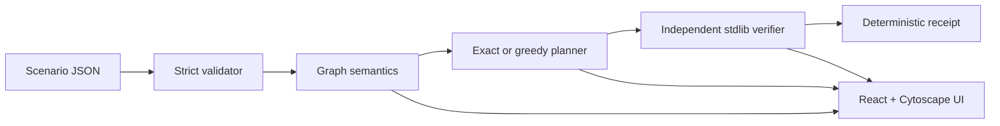

# CHOKEPOINT

CHOKEPOINT is a defensive remediation-planning engine for a **synthetic, modelled** smart-city / critical-infrastructure network. It finds a lowest-cost set of catalogue actions that removes logical origin-to-target reachability while preserving required service flows, then independently verifies the result and emits a deterministic receipt.

It does **not** scan, exploit, control, or change a real system. A graph edge is modelled reachability, not proof of exploitability. `VERIFIED` means the independent verifier accepted the modelled constraints; it is not a claim of real-world security, deployment, or optimality unless the solver status is `OPTIMAL`.

This is a separate, new build. It does not copy source or assets from ChronoForge, and it does not assert compliance with any competition's originality rules.

## How it works



The scenario owns all structure and action costs. The planner derives integer decihour costs as `effort_dh + 2*downtime_dh`. Exact search minimizes `(total cost, action count, sorted action IDs)` with deterministic node budgets. The verifier independently evaluates permissions, required flows, reachability, costs, exclusions, mandatory actions, and caps using a least-fixpoint formulation.

## Implemented features

- Strict versioned scenario validation with JSON-pointer-style paths and static warnings.
- Multi-reason attack graphs with exploit and credential causes.
- Zone/asset rule matching, restricted and removed rules, required-flow preservation.
- Exact branch-and-bound planning and greedy fallback with honest statuses.
- Independent standard-library-only verifier; it never calls the optimizer.
- Canonical JSON, scenario fingerprints, receipt fingerprints, and tamper detection.
- FastAPI health, scenario, graph, plan, and verify endpoints.
- CLI validation, planning, and verification.
- Interactive Cytoscape graph with compound zones, attack/rule/flow layers, node/edge selection, witness highlighting, fit/zoom/reset controls, and an accessible table fallback.
- Responsive workflow for Inspect, Plan, Verify, Compare, and Receipt.

## Repository structure

```text
backend/src/chokepoint/       core models, validation, graph, solver, API, CLI
backend/src/chokepoint_verifier/ independent parser, fixpoint, checks, receipts
backend/scenarios/             canonical and demo synthetic scenarios
backend/tests/                 unit, API, oracle, adversarial, receipt tests
frontend/src/                  React shell, Cytoscape graph, workflow views
frontend/e2e/                  Playwright journey
docs/                          architecture, algorithms, API, audit, testing
```

## Requirements

- Python 3.11+ (the current worker has Python 3.11.2; Python 3.12 was unavailable).
- Node 20+ and npm.
- No database, Docker, credentials, paid service, or runtime network integration.

## Setup and run

```bash
make setup
make test
make build
```

Run the two processes in separate terminals:

```bash
PYTHONPATH=backend/src backend/.venv/bin/python -m uvicorn chokepoint.api.app:app --host 127.0.0.1 --port 8000
cd frontend && npm run dev -- --host 127.0.0.1 --port 5173
```

Open `http://127.0.0.1:5173`. Backend health is available at `http://127.0.0.1:8000/api/v1/health`.

Optional configuration is documented in `.env.example`; do not put secrets in scenario files or committed environment files.

## CLI

```bash
PYTHONPATH=backend/src backend/.venv/bin/python -m chokepoint.cli validate backend/scenarios/canonical_city.json
PYTHONPATH=backend/src backend/.venv/bin/python -m chokepoint.cli plan backend/scenarios/canonical_city.json --json
PYTHONPATH=backend/src backend/.venv/bin/python -m chokepoint.cli verify backend/scenarios/canonical_city.json --actions A01,A02,A03,A04 --claimed-cost 200
```

The canonical scenario currently produces `OPTIMAL` with actions `A01,A02,A03,A04`, total cost `200 dh`, and independent verification `VERIFIED`.

## API and tests

The API base is `/api/v1`. The checked-in contract is `docs/openapi.json`; regenerate it with:

```bash
PYTHONPATH=backend/src backend/.venv/bin/python scripts/export_openapi.py
```

Run the checks independently or together:

```bash
make backend-test       # pytest: core, oracle, verifier, API, CLI, adversarial
make frontend-test      # Vitest + React Testing Library
make build              # TypeScript + production Vite build
make test               # backend and frontend suites
cd frontend && npm run e2e  # Playwright; starts both servers via config
```

The complete user journey is covered by the Playwright spec when the host has the required Chromium shared libraries: load scenario, inspect graph, compute, verify, compare, and view the receipt.

## Security boundaries and limitations

This is an offline analysis tool over synthetic inputs. It uses allow-only, protocol-agnostic rules and does not model exploit prerequisites, privilege levels, probability, timing, live feeds, authentication, deployment, or real CVE intelligence. A SHA-256 fingerprint is an integrity digest, not a signature, authentication, tamper-proof storage, or proof. Real-world use requires authorised data, operational review, and separate deployment controls.

The exact planner is exponential in the action catalogue. The demo is intentionally bounded to remain exhaustively testable. The production bundle currently reports a non-blocking chunk-size advisory because Cytoscape is included in the main bundle.

For evidence and remaining gaps, see `docs/ENGINEERING_AUDIT.md`, `docs/FINAL_REPORT.md`, and `docs/TESTING.md`.
